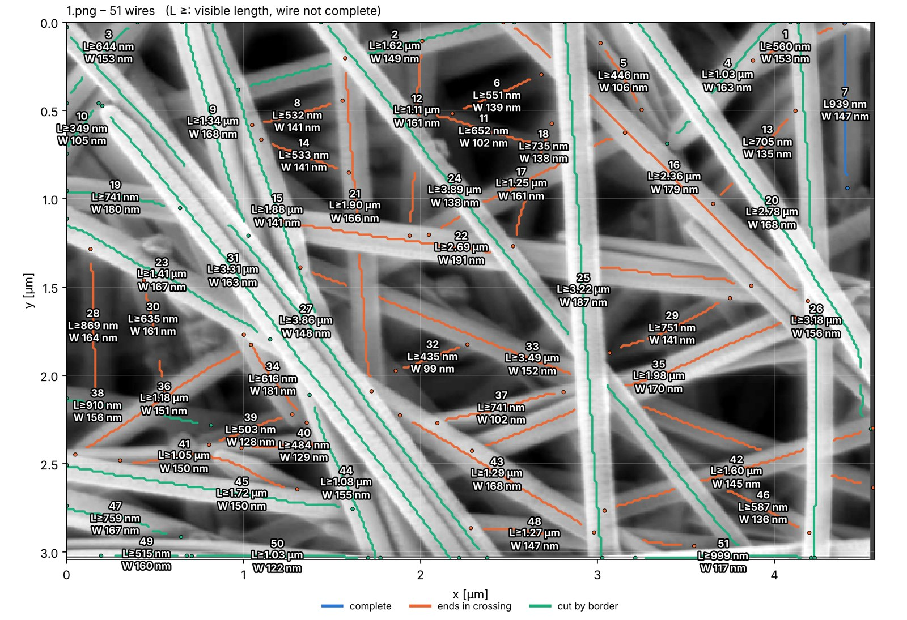

# AuNW Analysis

Measures the **length and width of every individual gold nanowire (AuNW)** in SEM
images of chaotic nanowire meshes, using a **Keras / TensorFlow** neural network
trained on **synthetic** SEM images. It produces statistics, fits and
exportable figures and tables.

The full scientific explanation of the design, with the mathematics, is in
**[docs/AuNW_Analysis_Design.pdf](docs/AuNW_Analysis_Design.pdf)**.


## Installation

**Windows (easiest):**
1. Install Python 3.12 from <https://www.python.org/downloads/> (tick *Add python.exe to PATH*).
2. Double-click **`install_windows.bat`** once. It installs everything and puts an
   **"AuNW Analysis" icon (a beaker with gold nanowires)** on your desktop and in the start menu.
3. From then on, just click the icon: the program opens in its own window.
   Closing the window quits the program.

`start_windows.bat` is an alternative that shows a console with log messages
and opens the program in the web browser (useful when something goes wrong).
Log files are in `%LOCALAPPDATA%\AuNWAnalysis`.

**Manual installation (all systems):**

```bash
python -m venv .venv
```

```bash
source .venv/bin/activate          # Windows: .venv\Scripts\activate
```

```bash
pip install -r requirements.txt
```

## Start the program

Click the desktop icon (Windows), or run the desktop window on any system:

```bash
python desktop.py
```

or, for the browser version:

```bash
streamlit run app.py
```

The blue column on the left lists the workflow steps, and the main area shows the selected step:

| Step | What you do |
|------|-------------|
| 1 · Synthetic data | configure the SEM simulator, preview examples, generate a training set |
| 2 · Network architecture | choose the U-Net size, view the diagram and layer table, look at feature maps |
| 3 · Training | train with live loss curves, over-fitting warning and validation previews |
| 4 · Validation | accuracy against synthetic ground truth, real annotated masks, or manual measurements |
| 5 · Load SEM images | TIFF/JPEG/PNG; info-bar cropping; nm/px from FEI, Zeiss or ImageJ metadata, typed in by hand, or from the scale bar |
| 6 · Analyse | overlay of all detected wires, network outputs, table of every wire |
| 7 · Results & export | summary statistics, histograms with fits; CSV, Excel, PNG/SVG/PDF, ZIP |
| 8 · Improve with real data | fine-tune the network on your own annotated micrographs |

A ready-to-use network is
included, so you can start analysing images in step 5 straight away. Training
started from the GUI runs as a separate process (`python -m aunw.cli train …`),
so it continues even if the browser is closed.

## Results for every single wire

In **step 6 (Analyse)**, the tab *Measured wires* shows the micrograph with
**every wire numbered**, drawn in colour and labelled with its **length and width**,
on a µm coordinate grid. Below it is the wire table. Select rows there to
highlight those wires on the map.

Export buttons in the same place:

| Button | Content |
|---|---|
| Map (PNG / PDF) | labelled map (with values, or IDs only) |
| Wires (CSV) | one row per wire: ID, status, length, width, aspect ratio, angle, start/end tip and centre coordinates in px and µm |
| Path points (CSV) | every traced centre-line point of every wire |
| Excel | sheets *Wires*, *Map (values)* and *Map (IDs)* (embedded images), *Path points*, *Info* |
| ZIP | all of the above for this image |
| All wires (CSV) / ZIP of all images | the same for every analysed image |

Coordinates have their origin at the top-left corner, with x to the right and y
downwards, as in ImageJ. For wires that end in a crossing or leave the image,
only the visible part is measured; their length is a lower bound, shown as
"L ≥ …" on the map and as `length_type = visible (lower bound)` in the table.



## Accuracy

The shipped network (`models/aunw_dense_f16`) was trained on synthetic images of
both sparse wires on a substrate and thick 3-D meshes as seen with an in-lens
detector. On synthetic test images with known truth:

| | dense 3-D meshes (coverage 55–97 %) | moderate meshes (coverage ≤ 30 %) |
|---|---|---|
| Width: median error per wire | −0.9 % | +0.3 % |
| Width: wires within ±10 % | 85 % | 62 % (incl. 3-px-thin wires) |
| Width: typical bias of an image's median | 2.7 % | 5.4 % |
| Length of complete wires: within ±10 % | – (ends hidden) | 94 % |

On two real micrographs (in-lens, 1 kV, 61 and 80 kX) the median widths were
151 nm and 144 nm, consistent across magnifications.

**Recommended protocol:** use high-magnification images (wires ≳ 10 px wide)
for the **width**, and lower-magnification images in which whole wires are
visible for the **length**. Each image is labelled with its areal coverage and a
reliability class; in very dense meshes the app reports width only, because
most wire ends are hidden. Details are in the PDF, section 10.

## Command line (e.g. training on a GPU server)

```bash
python -m aunw.cli generate --out data/synthetic --n-train 3000
```

```bash
python -m aunw.cli train --data data/synthetic --out models/unet_f24 --base-filters 24 --epochs 80
```

```bash
python -m aunw.cli evaluate --model models/unet_f24 --data data/synthetic
```

```bash
python -m aunw.cli analyze --model models/unet_f24 --nm-per-px 2.5 --out results/run1 images/*.tif
```

## Project structure

```
app.py                Streamlit entry point (sidebar + routing)
ui/common.py          styling, session state, shared widgets
ui/pages/*.py         one module per workflow step
aunw/config.py        all parameters (dataclasses)
aunw/io.py            image loading, normalisation, calibration
aunw/synthetic.py     physics-based synthetic SEM generator (exact labels)
aunw/dataset.py       dataset files, tf.data pipeline, augmentation
aunw/model.py         residual U-Net, losses, metrics
aunw/training.py      training, fine-tuning, live monitor, over-fitting report
aunw/inference.py     tiled prediction, test-time augmentation, auto-scale
aunw/measure.py       wire separation (skeleton graph) and measurement
aunw/stats.py         statistics, log-normal fits, edge correction, tests
aunw/evaluation.py    accuracy evaluation
aunw/plots.py         all figures
aunw/export.py        CSV / Excel / ZIP export
aunw/cli.py           command-line interface
tests/                pytest suite (python -m pytest)
```

If you want to learn from the code, a good reading order is
`synthetic.py` → `dataset.py` → `model.py` → `training.py` →
`inference.py` → `measure.py` → `stats.py`.

## Privacy

Everything runs locally. The web server listens only on `localhost`, and
Streamlit usage statistics are disabled (`.streamlit/config.toml`). No image
or result leaves the computer.
