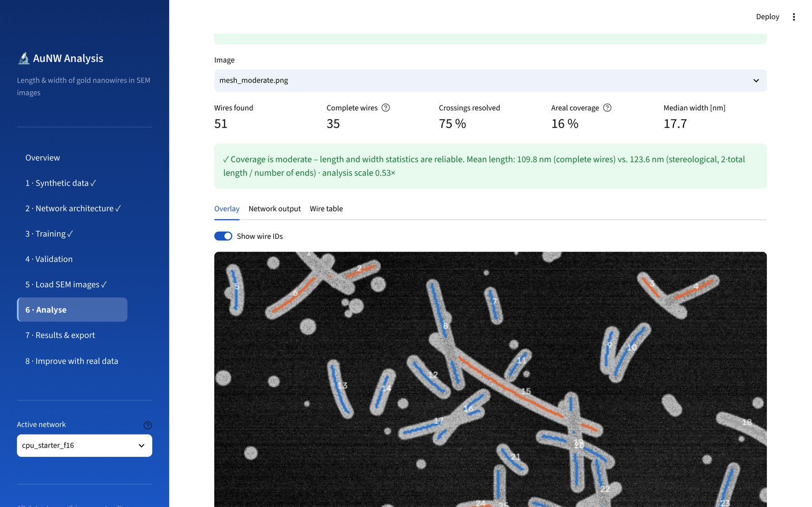

# AuNW Analysis

Measures the **length and width of every individual gold nanowire (AuNW)** in SEM
images of chaotic nanowire meshes, using a **Keras / TensorFlow** neural network
trained on **synthetic** SEM images. It produces statistics, fits and
exportable figures and tables.

The full scientific explanation of the design, with the mathematics, is in
**[docs/AuNW_Analysis_Design.pdf](docs/AuNW_Analysis_Design.pdf)**.



## Installation

**Windows (easiest):** install Python 3.12 from <https://www.python.org/downloads/>
(tick *Add python.exe to PATH*), then double-click **`install_windows.bat`** once
and afterwards **`start_windows.bat`** to start the program. The program opens in
your web browser at <http://localhost:8501>; keep the black console window open
while you work (closing it quits the program).

**Manual installation (all systems):**

```bash
python -m venv .venv
```

```bash
source .venv/bin/activate          # Windows: .venv\Scripts\activate
```

```bash
pip install -r requirements.txt
```

## Start the program

```bash
streamlit run app.py
```

The browser opens at `http://localhost:8501`. The blue column on the left
lists the workflow steps, and the main area shows the selected step:

| Step | What you do |
|------|-------------|
| 1 · Synthetic data | configure the SEM simulator, preview examples, generate a training set |
| 2 · Network architecture | choose the U-Net size, view the diagram and layer table, look at feature maps |
| 3 · Training | train with live loss curves, over-fitting warning and validation previews |
| 4 · Validation | accuracy against synthetic ground truth, real annotated masks, or manual measurements |
| 5 · Load SEM images | TIFF/JPEG/PNG; info-bar cropping; nm/px from FEI, Zeiss or ImageJ metadata, typed in by hand, or from the scale bar |
| 6 · Analyse | overlay of all detected wires, network outputs, table of every wire |
| 7 · Results & export | summary statistics, histograms with fits; CSV, Excel, PNG/SVG/PDF, ZIP |
| 8 · Improve with real data | fine-tune the network on your own annotated micrographs |

A ready-to-use network (`models/cpu_starter_f16`, trained for 2 h on a CPU) is
included, so you can start analysing images in step 5 straight away. Training
started from the GUI runs as a separate process (`python -m aunw.cli train …`),
so it continues even if the browser is closed.

## Accuracy (shipped network, synthetic test images with known truth)

| | moderate meshes (coverage 4–44 %) |
|---|---|
| Mask Dice | 0.982 |
| Length of complete wires: median error / within ±10 % | +0.4 % / 92 % |
| Width: median error / within ±10 % | −0.7 % / 92 % |
| Per image: typical bias of median length / median width | 4.4 % / 1.2 % |

The width is reliable at every density. Length needs visible wire ends, so
each image is labelled with its **areal coverage** and a reliability class
(good ≤ 30 % < caution ≤ 45 % < length unreliable). Each image also gets a
second, independent stereological mean length, ⟨L⟩ = 2 · total length / number of ends,
as a cross-check. The details are in the PDF, section 10.

## Command line (e.g. training on a GPU server)

```bash
python -m aunw.cli generate --out data/synthetic --n-train 3000
```

```bash
python -m aunw.cli train --data data/synthetic --out models/unet_f24 --base-filters 24 --epochs 80
```

```bash
python -m aunw.cli evaluate --model models/unet_f24 --data data/synthetic
```

```bash
python -m aunw.cli analyze --model models/unet_f24 --nm-per-px 2.5 --out results/run1 images/*.tif
```

## Project structure

```
app.py                Streamlit entry point (sidebar + routing)
ui/common.py          styling, session state, shared widgets
ui/pages/*.py         one module per workflow step
aunw/config.py        all parameters (dataclasses)
aunw/io.py            image loading, normalisation, calibration
aunw/synthetic.py     physics-based synthetic SEM generator (exact labels)
aunw/dataset.py       dataset files, tf.data pipeline, augmentation
aunw/model.py         residual U-Net, losses, metrics
aunw/training.py      training, fine-tuning, live monitor, over-fitting report
aunw/inference.py     tiled prediction, test-time augmentation, auto-scale
aunw/measure.py       wire separation (skeleton graph) and measurement
aunw/stats.py         statistics, log-normal fits, edge correction, tests
aunw/evaluation.py    accuracy evaluation
aunw/plots.py         all figures
aunw/export.py        CSV / Excel / ZIP export
aunw/cli.py           command-line interface
tests/                pytest suite (python -m pytest)
```

If you want to learn from the code, a good reading order is
`synthetic.py` → `dataset.py` → `model.py` → `training.py` →
`inference.py` → `measure.py` → `stats.py`.

## Privacy

Everything runs locally. The web server listens only on `localhost`, and
Streamlit usage statistics are disabled (`.streamlit/config.toml`). No image
or result leaves the computer.
